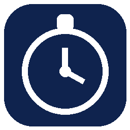

# Pomodoro Timer for Home Assistant



A simple Pomodoro timer you can control from Home Assistant. Set your focus and break lengths, start or pause a session, and use the timer's sensors and phase-change event in dashboards and automations.

## Features

- Configurable focus sessions, short breaks, long breaks, and focus sessions per cycle
- Start, pause, resume, skip to the next phase, and reset controls
- Sensors for the current phase and its expected end time
- A sensor showing minutes remaining until the next phase
- A Home Assistant event entity for phase changes
- A `pomodoro_phase_changed` event for automations
- English and German translations

## Installation

### HACS

1. In HACS, open **Integrations** and select the three-dot menu.
2. Choose **Custom repositories**.
3. Add `https://github.com/mrtncode/homeassistant-pomodoro-timer` and select **Integration** as the category.
4. Find **Pomodoro** in HACS and install it.
5. Restart Home Assistant.

### Manual

Copy the `custom_components/pomodoro` directory into the `custom_components` directory in your Home Assistant configuration, then restart Home Assistant.

## Setup

After restarting, go to **Settings → Devices & services → Add integration**, search for **Pomodoro**, and choose your timer name and durations. You can change the durations later from the integration's **Configure** option.

Durations are in minutes. Focus and break durations can each be set from 1 to 240 minutes. The number of focus sessions before a long break can be set from 1 to 12.

| Setting | Default |
| --- | ---: |
| Focus session | 25 minutes |
| Short break | 5 minutes |
| Long break | 15 minutes |
| Focus sessions before a long break | 4 |

## Entities

Each configured timer provides these entities (with entity IDs based on its name):

| Entity | Purpose |
| --- | --- |
| Phase sensor | Current phase: `idle`, `focus`, `short_break`, or `long_break`. Attributes include status and completed focus cycles. |
| Ends at sensor | Expected end time of the current phase; empty while idle or paused. |
| Remaining minutes sensor | Minutes remaining until the next phase; empty while idle and held at the remaining value while paused. |
| Phase changed event | Emits a `phase_changed` event with the timer's name, entry ID, previous phase, and new phase. |
| Start / pause button | Starts a focus session, pauses a running timer, or resumes a paused timer. |
| Next phase button | Skips to the next phase. |
| Reset button | Stops the timer and clears the cycle count. |

When a phase changes, the integration fires the `pomodoro_phase_changed` event with the timer's name, entry ID, previous phase, and new phase. For example, an automation can listen for the event like this:

```yaml
automation:
  - alias: "Announce Pomodoro phase changes"
    triggers:
      - trigger: event
        event_type: pomodoro_phase_changed
    actions:
      - action: persistent_notification.create
        data:
          title: "Pomodoro"
          message: "{{ trigger.event.data.name }}: {{ trigger.event.data.phase }}"
```

## License

This project is licensed under the [MIT License](LICENSE).
